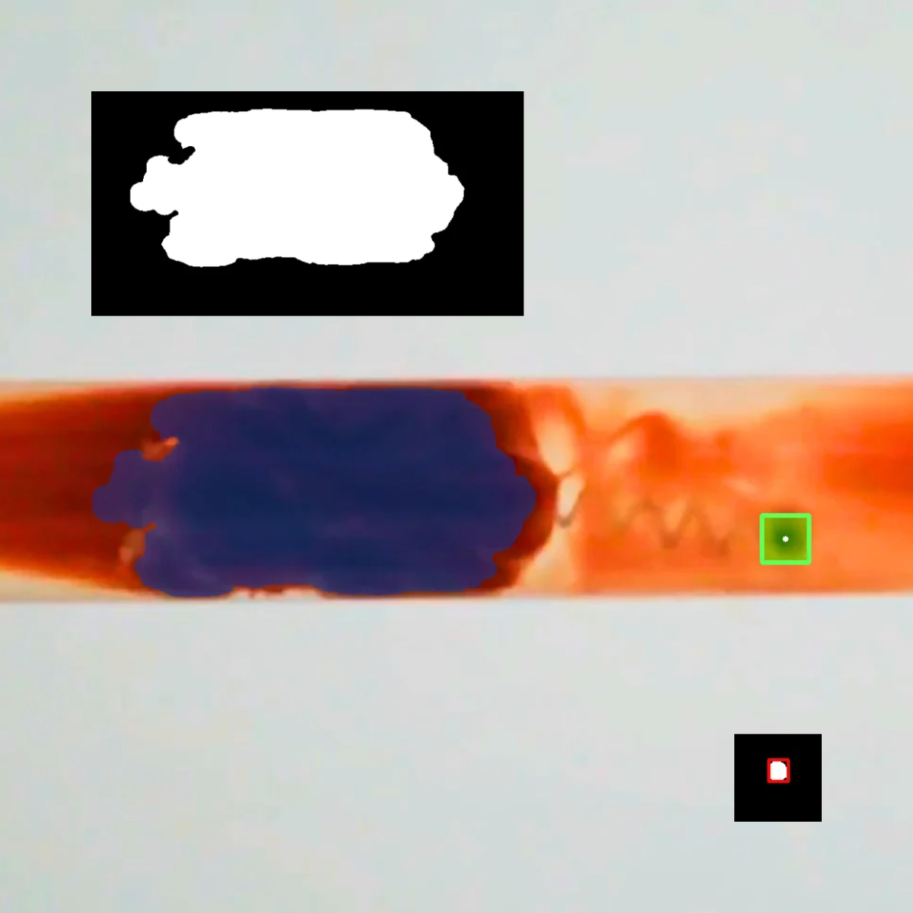
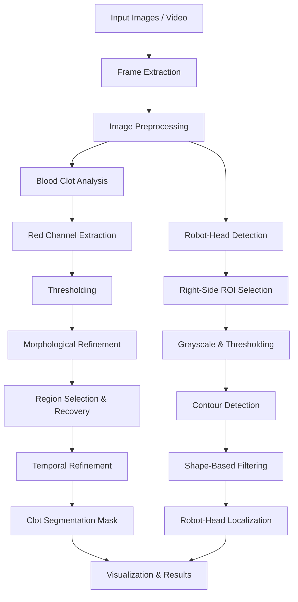

# Blood Clot Analysis using Computer Vision


A Python-based computer vision project for automated blood clot segmentation, area analysis, and robot-head detection in image and video data.

The project uses **classical computer vision techniques with OpenCV and NumPy**, without relying on deep-learning models or segmentation frameworks.

## Approach

The project explores traditional image-processing methods for biological image analysis, combining colour-channel analysis, thresholding, morphological refinement, contour detection, and temporal information.

## Pipeline Overview



## Features

### 1. Blood Clot Segmentation
- Red-channel-based image analysis.
- Gaussian smoothing and threshold.
- Morphological operations to refine segmentation.
- Connected-component analysis to identify the clot region.

### 2. Clot Visualization
- Semi-transparent overlay of the detected clot.
- Individual binary segmentation masks.
- Diagnostic images to inspect intermediate processing steps.

### 3. Robot-Head Detection
- Detection of the robot head within the rightmost third of the image.
- Grayscale conversion and threshold-based candidate extraction.
- Contour analysis using area, circularity, and aspect ratio.
- Visual bounding-box annotation.

## Output

The pipeline generates results such as:

- Segmentation masks.
- Clot overlays on original images.
- Intermediate diagnostic images.
- Robot-head detection visualizations.
- Area-analysis results, where enabled.

Results are saved in the configured output directory.
## Technologies

- Python
- OpenCV
- NumPy
- Matplotlib

## Project Structure

```text
blood_clot_cv_project/
│
├── clotcv/
│   ├── __init__.py
│   ├── cli.py
│   ├── pipeline.py
│   └── ...
│
├── input/
│   ├── images/
│   └── videos/
│
├── results/
│
├── requirements.txt
└── README.md
```

*The structure above is illustrative; adapt it to the actual files in your repository.*

## Installation

Clone the repository:

```bash
git clone https://github.com/daliamahdy/blood-clot-analysis-cv.git
cd blood-clot-analysis-cv
```

Create and activate a virtual environment:

```bash
python -m venv .clotenv
source .clotenv/bin/activate
```

Install dependencies:

```bash
pip install -r requirements.txt
```

## Usage

Run the analysis on a video:

```bash
python -m clotcv.cli --input "input/videos/v1.mp4" --every 10 --max-samples 20
```

Run the analysis on an image directory:

```bash
python -m clotcv.cli --input "input/images/Set1"
```

Adjust the input paths and command-line arguments according to your dataset and configuration.


